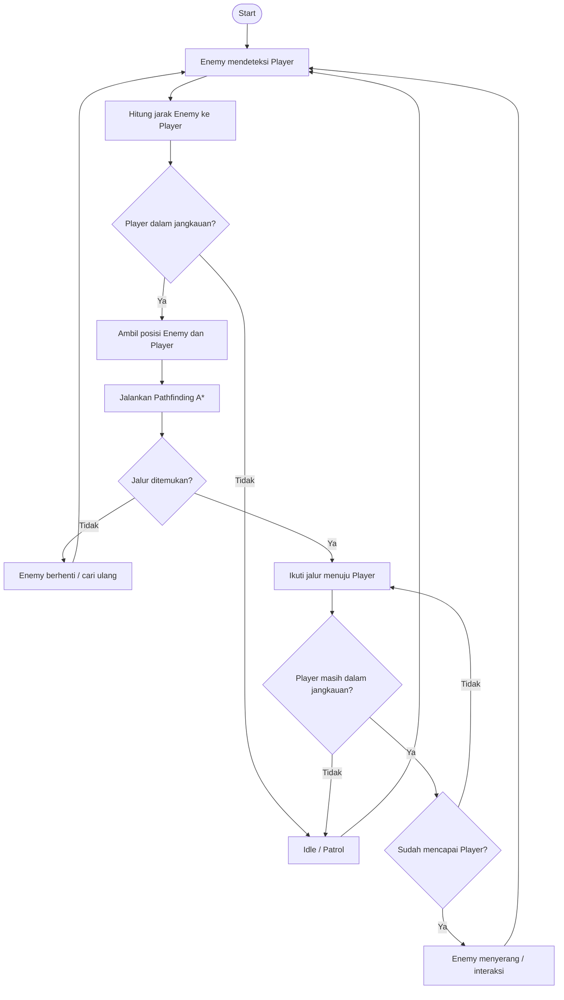

# Algoritma Enemy Mendeteksi dan Mengejar Player di Dungeon

## 1. Identifikasi Algoritma yang Digunakan

Pada kasus ini digunakan beberapa konsep algoritma/game AI:

1. **Distance Check / Euclidean Distance**
   Digunakan untuk menentukan apakah posisi Player berada dalam jangkauan deteksi Enemy.

   Rumus jarak 2D:

   `distance = √((x2 - x1)² + (y2 - y1)²)`

   Jika jarak Player lebih kecil atau sama dengan `detectionRange`, Enemy dapat mendeteksi Player.

2. **Pathfinding A***

   Setelah Player terdeteksi dan berada dalam jangkauan, Enemy mencari jalur terpendek dari posisi Enemy menuju posisi Player menggunakan algoritma **A\***.

   A* menggunakan fungsi:

   `f(n) = g(n) + h(n)`

   - `g(n)` = biaya perjalanan dari titik awal ke node saat ini.
   - `h(n)` = estimasi jarak dari node saat ini ke tujuan.
   - `f(n)` = total nilai yang digunakan untuk memilih node berikutnya.

3. **Movement**

   Setelah jalur ditemukan, Enemy bergerak mengikuti node-node pada hasil pathfinding sampai mencapai posisi Player.

### Alur Logika

- Enemy mendeteksi keberadaan Player.
- Hitung jarak Enemy dengan Player.
- Jika Player berada di luar jangkauan, Enemy tetap dalam kondisi idle/patrol.
- Jika Player berada dalam jangkauan, Enemy menjalankan A* untuk mencari jalur.
- Enemy mengikuti jalur hasil A*.
- Jika posisi Player berubah, jalur dapat dihitung kembali.
- Proses dilakukan berulang selama game berjalan.

---

## 2. Flowchart



---

## 3. Code Snippet

Contoh berikut menggunakan **Python** dan simulasi grid sederhana. Algoritma yang digunakan adalah Distance Check + A* Pathfinding.

```python
import math
import heapq

# Grid dungeon
# 0 = jalan
# 1 = tembok
grid = [
    [0, 0, 0, 0, 0, 0],
    [0, 1, 1, 0, 1, 0],
    [0, 0, 0, 0, 1, 0],
    [0, 1, 0, 0, 0, 0],
    [0, 0, 0, 1, 0, 0],
    [0, 0, 0, 0, 0, 0]
]

enemy = (0, 0)
player = (5, 5)

detection_range = 8


# ---------------------------------
# 1. Menghitung jarak Enemy-Player
# ---------------------------------

def distance(a, b):
    return math.sqrt(
        (a[0] - b[0]) ** 2 +
        (a[1] - b[1]) ** 2
    )


# ---------------------------------
# 2. Heuristic untuk A*
# ---------------------------------

def heuristic(a, b):
    # Manhattan distance
    return abs(a[0] - b[0]) + abs(a[1] - b[1])


# ---------------------------------
# 3. Mendapatkan tetangga node
# ---------------------------------

def get_neighbors(position):
    row, col = position

    directions = [
        (-1, 0),
        (1, 0),
        (0, -1),
        (0, 1)
    ]

    neighbors = []

    for dr, dc in directions:
        new_row = row + dr
        new_col = col + dc

        if (
            0 <= new_row < len(grid)
            and 0 <= new_col < len(grid[0])
            and grid[new_row][new_col] == 0
        ):
            neighbors.append((new_row, new_col))

    return neighbors


# ---------------------------------
# 4. Algoritma A*
# ---------------------------------

def a_star(start, goal):

    open_list = []

    heapq.heappush(
        open_list,
        (0, start)
    )

    came_from = {}

    cost_so_far = {
        start: 0
    }

    while open_list:

        _, current = heapq.heappop(open_list)

        if current == goal:
            break

        for neighbor in get_neighbors(current):

            new_cost = cost_so_far[current] + 1

            if (
                neighbor not in cost_so_far
                or new_cost < cost_so_far[neighbor]
            ):

                cost_so_far[neighbor] = new_cost

                priority = (
                    new_cost +
                    heuristic(neighbor, goal)
                )

                heapq.heappush(
                    open_list,
                    (priority, neighbor)
                )

                came_from[neighbor] = current

    # Jika tidak ditemukan jalur
    if goal not in came_from:
        return []

    # Membuat path dari goal ke start
    path = []
    current = goal

    while current != start:
        path.append(current)
        current = came_from[current]

    path.append(start)

    # Balik urutan agar start -> goal
    path.reverse()

    return path


# ---------------------------------
# 5. AI Enemy
# ---------------------------------

def enemy_ai(enemy_position, player_position):

    print("Enemy mendeteksi Player...")

    # Cek jarak
    current_distance = distance(
        enemy_position,
        player_position
    )

    print("Jarak Enemy ke Player:", current_distance)

    # Cek apakah Player berada dalam jangkauan
    if current_distance <= detection_range:

        print("Player berada dalam jangkauan!")

        # Cari jalur menggunakan A*
        path = a_star(
            enemy_position,
            player_position
        )

        if path:

            print("Jalur ditemukan:")
            print(path)

            # Enemy bergerak mengikuti path
            for position in path:
                print("Enemy bergerak ke:", position)

            print("Enemy mencapai Player.")

        else:
            print("Jalur menuju Player tidak ditemukan.")

    else:
        print("Player berada di luar jangkauan.")
        print("Enemy tetap idle/patrol.")


# Menjalankan AI
enemy_ai(enemy, player)
```

---

## Kesimpulan

Algoritma utama yang digunakan adalah **Distance Check** untuk mendeteksi apakah Player berada dalam jangkauan Enemy dan **A\*** untuk mencari jalur menuju Player.

Urutan prosesnya adalah:

**Detect Player → Hitung Jarak → Cek Jangkauan → A* Pathfinding → Enemy Bergerak → Sampai ke Player**

A* cocok digunakan pada dungeon berbasis grid karena dapat mencari jalur dengan mempertimbangkan tembok atau area yang tidak dapat dilewati.

## Struktur Repository GitHub

```text
enemy-ai-dungeon/
│
├── README.md
└── enemy_ai.py
```

`README.md` berisi penjelasan algoritma dan flowchart, sedangkan `enemy_ai.py` berisi implementasi Python.
